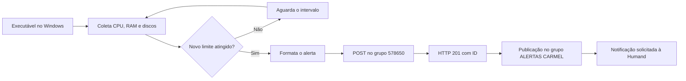

# Agente de alertas Humand — registro da implementação

Este documento registra o caminho desde o primeiro acesso autenticado à API até a publicação do alerta no grupo **ALERTAS CARMEL**, além do funcionamento da versão atual do agente Windows. Registro atualizado em **05/10/2026**.

## 1. Objetivo e resultado

Executar um agente `.exe` na máquina monitorada, coletar CPU, memória RAM e utilização dos discos locais e publicar na Humand quando alguma métrica atingir o limite configurado.

O resultado foi validado em duas etapas: a API confirmou a criação de uma publicação de teste com HTTP 201 e, depois, um alerta de RAM apareceu no grupo, conforme a captura apresentada pelo usuário.

**Entrega de push no celular:** não foi verificada separadamente. A presença da postagem no grupo confirma a publicação, mas não comprova a entrega de uma notificação no dispositivo.

## 2. Primeiro acesso à API

A chave fornecida foi mantida localmente no `.env`, sem ser inserida no código ou no executável. A autenticação usada e validada foi:

```http
Authorization: Basic <CHAVE_DA_API>
```

O primeiro teste foi uma consulta de leitura, sem criar mensagens ou modificar grupos:

```http
GET https://api-prod.humand.co/api/v1/marty/me.unreads
```

Sem credencial, a API retornou HTTP 401, confirmando a conexão HTTPS. Com a chave, retornou HTTP 200, confirmando acesso autenticado ao endpoint.

Esse teste inicial foi feito na Marty, a API de chats indicada na [documentação Marty](https://api-prod.humand.co/marty/docs/swagger-ui/index.html#/). Ele validou a comunicação, mas ainda não validava a publicação no grupo desejado.

## 3. Identificação do destino correto

A consulta de conversas da Marty não encontrou **ALERTAS CARMEL**. Retornou apenas um chat privado chamado **Teste Monitoramento TI**, cujo único membro era o usuário associado à integração.

A imagem do painel administrativo esclareceu a diferença: **ALERTAS CARMEL era um grupo de publicações, não um grupo de chat**. A conta **Usuario Integração** já estava incluída como administradora desse grupo.

A URL fornecida pelo usuário permitiu identificar o grupo:

```text
https://admin.humand.co/groups/578650/edit
```

Portanto, o destino passou a ser o grupo de publicações de ID **578650**. A API Marty deixou de ser necessária para o fluxo do agente.

## 4. Teste de publicação no grupo

O contrato da [API pública Humand](https://api-prod.humand.co/public/api/v1/api-docs/) documenta a operação de criação de publicação em grupo:

```http
POST https://api-prod.humand.co/public/api/v1/groups/578650/posts
Authorization: Basic <CHAVE_DA_API>
Content-Type: application/json
Accept: application/json
```

O envio de teste usou um texto identificado como teste e solicitou notificação:

```json
{
  "body": "[TESTE DE INTEGRAÇÃO] Agente Go conectado à API Humand. Publicação de teste; nenhuma condição de alerta foi detectada.",
  "sendNotification": true
}
```

Resultado observado:

| Informação | Resultado |
| --- | --- |
| Grupo | ALERTAS CARMEL |
| ID do grupo | 578650 |
| Resposta HTTP | 201 Created |
| ID da publicação de teste | 7897637 |
| Notificação solicitada | `sendNotification: true` |

O usuário confirmou que o teste funcionou. Isso validou autenticação, acesso ao grupo e criação da publicação pela integração.

## 5. Implementação do agente Windows

O agente foi desenvolvido em Go e consolidado em um único arquivo de implementação: [agent.go](agent.go). As chamadas de baixo nível do Windows foram substituídas pela biblioteca `gopsutil`, deixando a coleta mais legível.

As dependências ficam incorporadas ao executável; não é necessário instalar Go ou essas bibliotecas na máquina monitorada.

| Componente atual | Responsabilidade |
| --- | --- |
| `loadEnv` e `loadConfig` | Ler a chave, o grupo, o intervalo e os limites; validar os valores |
| `collect` | Coletar CPU, RAM e discos locais fixos |
| `newAlerts` | Identificar métricas que atingiram o limite e controlar repetição |
| `report` e `percent` | Formatar o texto da publicação |
| `publish` | Enviar o POST autenticado e verificar a resposta |
| `run` | Executar continuamente até o encerramento do processo |

Não há fila, banco de dados, arquivo de estado, regra de duração ou serviço Windows instalado.

## 6. Configuração usada

O modelo sem credenciais está em [.env.example](.env.example). Para a primeira configuração, copie-o **somente se ainda não existir um `.env`**:

```powershell
Copy-Item -LiteralPath .env.example -Destination .env
```

Depois, preencha `HUMAND_API_KEY` no `.env` e ajuste o grupo, o intervalo e os limites. O modelo usa 90% para CPU, RAM e disco. Se o `.env` já estiver configurado, use o modelo como referência, sem substituir sua chave.

O `.env` contém a chave real e está no `.gitignore`. Abaixo está a configuração observada no registro, com a credencial substituída por um marcador:

```dotenv
HUMAND_API_KEY=<CHAVE_DA_API>
HUMAND_AUTH_SCHEME=Basic
HUMAND_GROUP_ID=578650
AGENT_INTERVAL=30s
AGENT_CPU_HIGH=90
AGENT_RAM_HIGH=40
AGENT_DISK_HIGH=90
```

O limite de RAM foi reduzido para **40%** durante a validação. A captura mostrou RAM em **46%**, acima desse limite, provocando o alerta. O valor inicial de referência do agente era 90%; os limites efetivos são os definidos no `.env` de cada máquina.

`AGENT_DISK_HIGH` se aplica a cada disco fixo separadamente. O agente identifica a máquina pelo hostname do Windows. Variáveis de ambiente do processo têm prioridade sobre o `.env`.

O executável procura o `.env` em sua própria pasta. Se não o encontrar ali, usa a pasta de execução. Também aceita um caminho explícito com `-env`.

## 7. Da coleta até a chegada do alerta



1. O processo carrega a configuração e inicia a coleta.
2. CPU é medida em uma janela de um segundo. RAM e disco são leituras instantâneas de percentual de uso. Apenas unidades locais fixas entram no monitoramento de disco.
3. Cada métrica é comparada com seu limite. Uma leitura **igual ou superior** ao limite pode gerar alerta.
4. Métricas que atingirem o limite no mesmo ciclo são reunidas em uma postagem, acompanhadas das demais leituras.
5. O agente envia a publicação pela API pública, com a chave e `sendNotification: true`.
6. HTTP 201 com um ID válido confirma a criação. O agente registra `Alerta publicado: <ID>` no terminal.
7. A postagem aparece no grupo e a Humand processa a solicitação de notificação. O push depende das permissões, configurações da plataforma e do dispositivo.

O intervalo configurado é a espera ao fim de cada ciclo. O tempo total entre coletas também inclui a coleta e, quando houver alerta, a chamada HTTP.

Depois do alerta, o agente mantém um controle em memória para evitar repetição da mesma métrica enquanto ela permanecer acima do limite. Quando uma leitura voltar abaixo dele, um novo alerta fica permitido. Falha de coleta não rearma o alerta. Reiniciar o processo reinicia esse controle.

## 8. Publicação recebida e melhoria visual

A captura fornecida pelo usuário mostrou uma publicação do **Usuario Integração** com o motivo `limite atingido em RAM`, RAM em 46% e limite em 40%. Essa foi a evidência visual de que o fluxo de coleta, decisão e publicação chegou ao grupo.

Depois, o texto foi reorganizado: recursos em alerta primeiro, demais recursos separados, percentuais com vírgula decimal e data no formato brasileiro. Exemplo ilustrativo do formato atual:

```text
Alerta de sistema
Máquina: DESKTOP-DL1MLP0

Limites atingidos
• RAM: 46% de uso (limite: 40%)

Demais recursos
• CPU: 20,8% de uso
• Disco C: 50,5% de uso
• Disco D: 52% de uso
• Disco E: 32,5% de uso

Coleta: 04/10/2026 às 23:52:04
```

A data e a hora do texto vêm do relógio e do fuso local do Windows. O horário relativo exibido pela Humand, como “1 minuto atrás”, é produzido pela plataforma.

O nome do autor vem da conta vinculada à chave, não do hostname da máquina. O contrato de publicação não possui campo para escolher outro nome por postagem. Para mudar **Usuario Integração**, edite o nome da conta em **Humand Admin → Usuários**. Isso altera a identidade da conta em todas as integrações que a utilizam. [Instruções oficiais de edição de usuário](https://help.humand.co/hc/pt/articles/26034989660051-Como-fa%C3%A7o-para-editar-um-usu%C3%A1rio-individualmente)

## 9. Tratamento de falhas e limites

O cliente usa HTTPS, timeout de 15 segundos e não segue redirecionamentos. A chave e o corpo das respostas da API não são registrados nos logs.

| Situação | Comportamento implementado |
| --- | --- |
| Uma métrica falha | Registra a falha; não dispara alerta para essa leitura e a apresenta como indisponível no relatório |
| HTTP 201 com ID válido | Confirma e registra a publicação |
| HTTP 429 | Respeita `Retry-After`; sem valor válido, considera 60 segundos; depois faz nova coleta |
| HTTP 401, 403 ou 404 | Registra erro e encerra o agente |
| Outros erros HTTP, timeout ou resposta sem ID | Registra a falha e suprime novos envios daquele episódio, evitando duplicação |

A política conservadora de envio pode perder um aviso: se uma tentativa falhar sem criar a postagem, o mesmo episódio não é reenviado automaticamente, exceto no tratamento de HTTP 429. Não há armazenamento durável ou reenvio garantido.

Uma consulta autenticada a `GET /public/api/v1/users/me` retornou `RateLimit-Policy: 100;w=60`: 100 requisições em uma janela de 60 segundos para aquela consulta. **Não validado:** se o endpoint de publicação tem a mesma cota e como ela é compartilhada entre máquinas ou chaves. A documentação pública explica os cabeçalhos `RateLimit-Policy`, `RateLimit` e `Retry-After`. [Referência da API pública](https://api-prod.humand.co/public/api/v1/api-docs/)

## 10. Compilação e execução

Para desenvolvimento, o projeto requer Go 1.26 ou superior. As versões das dependências estão em [go.mod](go.mod) e [go.sum](go.sum).

```powershell
go test ./...
go vet ./...
go build -o humand-agent.exe agent.go
```

Na máquina monitorada, são necessários apenas `humand-agent.exe` e `.env` na mesma pasta:

```powershell
.\humand-agent.exe
```

Para visualizar uma coleta sem publicar:

```powershell
.\humand-agent.exe -once -dry-run
```

Para executar um ciclo com envio habilitado, publicando somente se algum limite for atingido:

```powershell
.\humand-agent.exe -once
```

`Ctrl+C` encerra o agente. Ele não inicia automaticamente com o Windows; fechar o processo interrompe o monitoramento. Depois de recompilar ou trocar o executável, é necessário reiniciar a instância em execução para carregar a nova versão.

## 11. Validações e limites do que foi comprovado

| Validação realizada durante a implementação | Evidência |
| --- | --- |
| Comunicação HTTPS | HTTP 401 na consulta inicial sem chave |
| Autenticação | HTTP 200 com a chave no teste de leitura |
| Acesso de escrita ao grupo | HTTP 201 e publicação de teste ID 7897637 |
| Chegada de alerta ao grupo | Captura do alerta de RAM apresentada pelo usuário |
| Coleta real no Windows | Leituras de CPU, RAM e discos C:, D: e E: em execução local |
| Disparo e controle de repetição | `TestAlertAndRearm` em [agent_test.go](agent_test.go) |
| Contrato HTTP e solicitação de notificação | `TestPublish`, com servidor HTTP local |
| Erros de resposta e espera em HTTP 429 | `TestPublishErrors`, com servidor HTTP local |
| Compilação e análise estática | Build e `go vet` executados com sucesso |
| Formato atualizado do relatório | Prévia local do executável, sem publicação adicional |

Os testes automatizados de HTTP usam um servidor local; não enviam publicações reais à Humand. Este registro documenta as validações já realizadas, não uma nova execução de testes ou envio de alerta.

**Não validado:** entrega de push em um celular específico, início automático, execução contínua por longos períodos e operação simultânea de várias máquinas. Uma condição breve entre coletas pode não ser detectada; a versão atual não monitora a disponibilidade do próprio agente.
